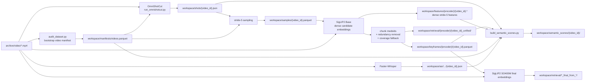
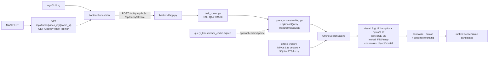
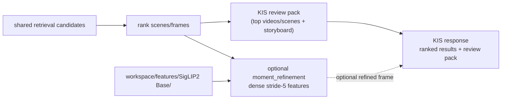
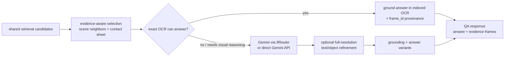
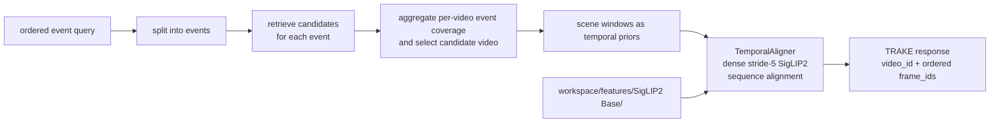

# Luồng dữ liệu và nơi lưu

Tài liệu này lần theo dữ liệu theo code production hiện tại: từ video đầu vào, qua các stage offline, vào index, rồi tới truy vấn KIS/QA/TRAKE. Các path dưới đây tính từ project root.

> `workspace/` không được commit và hiện chưa có trong checkout này. Sơ đồ mô tả artifact contract mà code đọc/ghi, không khẳng định mọi artifact đang tồn tại trên máy. `archive/video/` và `models/` là dữ liệu ngoài Git.

## 1. Các flow chính

Đọc theo thứ tự: chuẩn bị dữ liệu một lần (Flow A), đóng gói index (Flow B),
rồi phục vụ từng request (Flow C và một nhánh task D/E/F). Flow A/B chạy offline;
Flow C-F chạy khi người dùng gửi query.

### Flow A — Bootstrap manifest rồi tạo evidence theo scene (offline)

Chạy audit khi cần tạo hoặc làm mới manifest. Các stage production cần
`videos.parquet` (gồm `video_id`, `video_path`, thông tin decode như FPS/frame
count và `video_readable`). Nếu manifest hiện có đã đúng và đầy đủ, có thể bỏ
qua audit khi chạy lại pipeline. Audit không đọc map, ảnh keyframe hay CLIP
features được cung cấp sẵn.

### Flow B — Enrichment và build global index (offline)

```mermaid
flowchart LR
    SCENEJSON["workspace/semantic_scenes/{video_id}/scenes.json"] --> VLM["VLM scene enrichment\n(contact sheets + 9Router)"]
    MANIFEST["workspace/manifests/videos.parquet\nfield: video_path"] --> VIDEO["source video .mp4"]
    VIDEO --> VLM
    VLM --> BATCH["workspace/gemini_batches/{video_id}/\nrequests.jsonl + responses.jsonl"]
    BATCH --> PARSED["Parse VLM responses"]
    PARSED --> VLMOUT["workspace/gemini_parsed/{video_id}/\nscenes.jsonl"]

    SCENEPQ["workspace/semantic_scenes/{video_id}/scenes.parquet\n(scene bounds + asr_exact/context)"] --> OBJECTS["YOLO-World object detection"]
    VIDEO --> OBJECTS
    FIDX["workspace/retrieval/google_siglip2_so400m_patch14_384/\n{video_id}_final_from_google_siglip2_base_patch16_224/metadata.parquet"] --> OBJECTS
    OBJECTS --> OBJOUT["workspace/objects_yoloworld/{video_id}/\ndetections.parquet + report.json"]

    VIDEO --> OCR["Full-resolution OCR (PP-OCR)"]
    FIDX --> OCR
    OCR --> OCROUT["workspace/ocr_fullres/{video_id}/\nregions.parquet + crops/reports"]

    TRANSCRIPT["workspace/asr/faster_whisper_large_v3/\n{video_id}.json"] --> ASNORM["Optional correction of uncertain ASR\n(prepare + 9Router + parse)"]
    ASNORM --> ASNOUT["workspace/asr_normalization/{video_id}/\nrequests.jsonl + responses.jsonl\nreport.json + normalized.json"]

    SCENEPQ --> DOCS["Build unified scene documents"]
    VLMOUT --> DOCS
    OBJOUT --> DOCS
    OCROUT --> DOCS
    ASNOUT --> DOCS
    DOCS --> SD["workspace/scene_documents/{video_id}/\nscenes.jsonl + scenes.parquet + report.json"]

    FIDX --> BUILD["Build offline hybrid index"]
    SD --> BUILD
    SCENEPQ --> BUILD
    BUILD --> INDEX["workspace/offline_index*/\nscenes/frames.parquet + SigLIP vectors\n+ search.sqlite3"]
    INDEX --> BGE["Build BGE-M3 scene vectors"]
    BGE --> INDEX
    MANIFEST --> OPEN["Build optional OpenCLIP frame index"]
    INDEX --> OPEN
    OPEN --> INDEX
    INDEX --> MILVUS["Build Milvus Lite HNSW index"]
    MILVUS --> FINALINDEX["milvus_lite.db\n+ milvus_report.json"]
```

Trong sơ đồ, `{video_id}` là ID như `L21_V001`. Đường dẫn video gốc được lấy
từ cột `video_path` của `workspace/manifests/videos.parquet`; các nhánh OCR và
object detection dùng `metadata.parquet` trong SO400M Final để biết frame nào
cần xử lý và timestamp/shot tương ứng. Transcript thô đã được Faster-Whisper
tạo ở Flow A và nằm trong `scenes.parquet` dưới dạng `asr_exact`/`asr_context`;
nhánh ASR ở Flow B chỉ sửa có điều kiện các đoạn đáng ngờ. Unified scene
documents lấy ASR thô từ semantic scenes và chỉ đọc `normalized.json` nếu có.

Các bước đóng gói index chạy theo thứ tự: `build_offline_hybrid_index.py` tạo
scene/frame metadata, SigLIP vectors và SQLite FTS; `build_bge_m3_scene_index.py`
tạo các vector văn bản BGE-M3; `build_openclip_frame_index.py` (tùy chọn) đọc
frame metadata cùng video gốc để tạo OpenCLIP vectors; cuối cùng
`build_milvus_index.py` đọc các vector và metadata đã tạo để lập ANN collections.
Milvus không tính lại embeddings và không thay thế các file Parquet/NumPy nguồn.

Enrichment branches có thể chạy độc lập sau khi artifact đầu vào sẵn sàng.
`run_flow_a_scheduler.py` điều phối riêng Flow A sau khi manifest đã sẵn sàng.
Semantic scenes chờ SigLIP2 Base (dense features + keyframes) và ASR; nó không
chờ SO400M Final. Nhánh SO400M Final vẫn chạy từ SigLIP2 Base song song để
cấp visual vectors cho retrieval và frame metadata cho OCR/object detection.
`run_dataset_scheduler.py` theo dõi các stage local rộng hơn; supervisors điều
phối worker/enrichment. Build index toàn cục là bước riêng sau khi scene
documents đã sẵn sàng.

### Flow C — Request chung: browser tới retrieval candidates (online)

### Flow D — KIS: tìm video/frame (online)

Luồng đang chạy dùng shared retrieval của Flow C để xếp hạng candidates và
tạo review pack. Dense moment refinement được thiết kế nhưng chưa được gọi từ
request handler hiện tại.

### Flow E — QA: tìm evidence rồi trả lời (online)

Backend trả candidates; frontend chọn frame/evidence và gọi riêng
`POST /api/qa/answer` để gửi câu hỏi cùng ảnh tới Google AI Studio hoặc 9Router.

### Flow F — TRAKE: tìm chuỗi sự kiện theo thứ tự (online)

Request handler hiện tách query thành event, truy vấn từng event qua cùng
`OfflineSearchEngine`, rồi kiểm tra thứ tự candidates bằng `frame_id`. Dense
`TemporalAligner` trong sơ đồ là bước refinement dự kiến, chưa được nối vào
handler hiện tại.

Flow D/E dùng chung retrieval candidates từ engine; TRAKE tạo retrieval riêng
cho từng event trong query. Output quay về service dưới dạng JSON. Service trả
response cho frontend. `/api/frame/{video_id}/{frame_id}` giải mã
và cache JPEG từ video trong manifest; `/videos/{video_id}.mp4` stream video
gốc, không sao chép media vào index.

`run_flow_a_scheduler.py` tracks Flow A independently in its own SQLite database. `run_dataset_scheduler.py` tracks broader local processing/enrichment stages; the full-dataset and Gemini-subset supervisors coordinate those stages and downstream index jobs. The schedulers themselves do not build a global index.

## 2. Stage offline và artifact

| Stage | Reads | Writes | Purpose |
|---|---|---|---|
| Dataset audit | `archive/video/**/*.mp4` | `workspace/manifests/videos.parquet` (8 columns); `workspace/reports/dataset_audit.json` | Canonical video IDs, paths, FPS, frame counts, duration, readability, duplicate count and file size. |
| Shot detection | video path from manifest; OmniShotCut checkpoint under `models/` | `workspace/shots/{video_id}.json` | Half-open shot ranges `[start, end)`, labels and decoded frame count for downstream validation. |
| Sampling | shot JSON and video manifest | `workspace/samples/{video_id}.parquet` | Per-frame IDs, shot IDs, shot boundaries, timestamps and sampling reasons; production uses stride 5 plus each shot's start, middle and end anchors. |
| SigLIP2 Base | sampled frames and source video | `workspace/features/google_siglip2_base_patch16_224/{video_id}.parquet` and `.f16.npy` | Dense stride-5 embeddings and metadata for temporal refinement and keyframe selection. |
| Adaptive keyframe selection | dense Base embeddings + metadata | `workspace/keyframes/{encoder_id}/{video_id}.parquet` | Selects chunk medoids, removes redundancy and fills temporal coverage gaps. |
| Base unified index | selected keyframes and dense Base features | `workspace/retrieval/{base}/{video_id}_unified/` | Compact visual index for selected frames; dense stride-5 features remain in `workspace/features/{base}/` for temporal refinement. |
| SigLIP2 SO400M Final | Base-selected keyframe manifest and source video | `workspace/retrieval/google_siglip2_so400m_patch14_384/{video_id}_final_from_google_siglip2_base_patch16_224/` (`embeddings.npy`, `metadata.parquet`, `config.json`) | Re-embeds selected frames for visual retrieval and supplies frame timestamps/shot IDs to OCR and object detection. Metadata keeps only `video_id`, `frame_id`, `pts_time` and `shot_id`; scene construction uses Base features separately. |
| ASR | source video path from `videos.parquet` | `workspace/asr/faster_whisper_large_v3/{video_id}.json` | Compact transcript with `video_id`, model, detected language, duration and segments. Each segment stores start/end/text, `avg_logprob` and its word timestamps/text/probability. |
| Semantic scenes | shots, dense Base features, selected keyframes, ASR and video manifest | `workspace/semantic_scenes/{video_id}/scenes.parquet`, `scenes.json`, `report.json` | Merges adjacent technical shots using Base-feature similarity and timing/ASR/transition rules. Parquet is the compact downstream contract; JSON retains representative-frame details and merge diagnostics for VLM preparation and review. SO400M Final embeddings are a separate branch and are not read by this builder. |
| Full-resolution OCR | source video + SO400M frame metadata | `workspace/ocr_fullres/{video_id}/regions.parquet`, crops, candidates, reports | PP-OCRv6 medium detection/recognition on original-resolution final keyframes; report records expected/decoded frames and model IDs. Low-confidence crops are distributed across scenes for optional 9Router review. |
| Objects/spatial evidence | source video, SO400M metadata and semantic scenes | `workspace/objects_yoloworld/{video_id}/detections.parquet` and `report.json` | Frame-level labels, confidence, normalized boxes and scene mapping. Detection rows keep only fields consumed by unified scene documents. |
| Scene VLM enrichment | semantic scenes, selected source frames and contact sheets | `workspace/gemini_batches/{video_id}/` requests/responses; parsed output at `workspace/gemini_parsed/{video_id}/scenes.jsonl` | Remote 9Router scene summaries, OCR lines, entities, actions and keywords. Legacy `gemini` names remain in artifact paths. |
| Optional ASR normalization | `workspace/asr/faster_whisper_large_v3/{video_id}.json` raw segments and neighbors | `workspace/asr_normalization/{video_id}/` (`requests.jsonl`, `responses.jsonl`, `report.json`, `normalized.json`) | Conditional correction of uncertain segments. `normalized.json` stores only `start`, `end` and `normalized_text`; the raw transcript remains in the Faster-Whisper source file. |
| Unified scene documents | semantic scenes + parsed VLM + objects + full-res OCR + optional normalized ASR | `workspace/scene_documents/{video_id}/scenes.jsonl`, `scenes.parquet`, `report.json` | Schema 0.5.0 consolidates search text and structured evidence; the report lists source availability/coverage, OCR raw/searchable/filtered counts and warnings for missing or incomplete inputs. |

The full-resolution OCR crop response parser updates `regions.parquet` in place with `gemini_text`, `final_text` and verification fields. Unified scene documents preserve accepted full-resolution OCR text with frame IDs, timestamps and polygons; the offline index carries those frame IDs into OCR evidence. Semantic-scene construction reads word timestamps nested under each ASR segment. Conditional ASR normalization uses segment confidence and word probabilities; its parser writes only timestamps and normalized text, leaving the raw transcript in the Faster-Whisper source file. The scene-document builder then uses searchable full-resolution OCR and prefers normalized ASR when available.

## 3. Offline index toàn cục

Default output is `workspace/offline_index/`; production can build other named roots such as `workspace/offline_index_all_873/` or `workspace/offline_index_{video_id}/`.

| File | Contents / alignment |
|---|---|
| `scenes.parquet` | One row per scene, with `row_id`, `document_id`, `video_id`, time/frame bounds, retrieval text, ASR/OCR/entity/object evidence and representative frames. |
| `scene_embeddings.npy` | Pooled SO400M vectors in `scenes.parquet` row order. |
| `frames.parquet` | One row per indexed final frame, with `frame_row`, `scene_row`, `video_id`, `frame_id` and `pts_time`. |
| `frame_embeddings.npy` | Normalized SO400M vectors in `frames.parquet` row order. |
| `text_embeddings_bge_m3.npy` | BGE-M3 vectors of scene `retrieval_text`, aligned with `scenes.parquet`. |
| `text_embeddings_bge_m3_summary.npy`, `_asr.npy`, `_ocr_entities.npy` | Optional field-specific BGE vectors, also aligned by scene row. |
| `text_embeddings_bge_m3.parquet` | ID sidecar (`row_id`, document/video IDs and scene index) for text vectors. |
| `frame_embeddings_openclip.npy` | Optional OpenCLIP frame vectors; aligned with `frames.parquet`. `openclip_frame_keys.parquet` is the incremental-build key sidecar. |
| `search.sqlite3` | `scenes` lookup table and FTS5 tables `scene_fts` and `fuzzy_fts` for lexical and character n-gram retrieval. |
| `report.json`, `bge_m3_report.json`, `openclip_report.json` | Build coverage, dimensions, skips and model details. |
| `milvus_lite.db` | Derived Milvus Lite database with HNSW/COSINE collections for scene and frame vectors; required by the current `OfflineSearchEngine`. |
| `milvus_report.json` | Collection counts, vector dimensions, source fingerprints, HNSW settings and sampled ANN recall against exact cosine search; required to validate the database at engine startup. |

`row_id`/array position is the canonical join for scene vectors; `scene_row` joins frame metadata to a scene. SQLite FTS uses one-based FTS rowids while its row lookup and NumPy/Parquet indices are zero-based; the search engine converts between them. Keep metadata and vector files from the same index build together.

`scripts/build_milvus_index.py` is the final index step after the global index, BGE-M3 and optional OpenCLIP builders. It reads the existing `.npy` and Parquet files without recomputing embeddings. Scene vectors are split into `scene_siglip` and four BGE collections; frame vectors are split into `frame_siglip` and optional `frame_openclip`. If Gemini text vectors exist at build time, it also creates `gemini_text`. Each collection stores only the Parquet row ID and vector; query results join IDs to scene/frame metadata through Parquet. The builder creates HNSW indexes with COSINE distance, samples each collection and records recall against exact NumPy cosine search. Milvus is a derived ANN index; Parquet and NumPy remain its reproducible sources.

Legacy index dumps can be imported with `scripts/import_legacy_offline_index.py`.
It copies only serving Parquet/vector artifacts, validates row alignment and
finite vectors, creates the OpenCLIP key sidecar from `frames.parquet`, rebuilds
`search.sqlite3`, and excludes stale backup files and the optional query cache.

## 4. Truy vấn online và dữ liệu runtime

1. FE sends the selected task and query to `POST /api/query` or `/api/query/stream`.
2. `OfflineSearchEngine.search` constructs query intent/variants, optionally expands with local Qwen, and retrieves top-k candidates from Milvus HNSW for SigLIP2, BGE-M3 and optional OpenCLIP. SQLite FTS/fuzzy search, object/spatial evidence and the reranker remain separate branches in score fusion.
3. KIS returns ranked scenes/frames. Dense moment refinement is not currently wired into the API.
4. QA retrieves scene/frame candidates; FE can send selected images to `/api/qa/answer` through Google AI Studio or 9Router.
5. TRAKE retrieves each ordered event and checks candidate frame order; dense temporal alignment is not currently wired into the API.
6. The service returns JSON; the frontend displays results and serves media from the same backend.

Runtime storage:

- `workspace/{index}/query_transformer_cache.sqlite3`: cached Qwen structured query parses.
- `workspace/{index}/gemini_text_cache.sqlite3`: optional 9Router text expansion cache; online Gemini text embedding is disabled because the router does not expose embeddings.
- `workspace/ui_frame_cache/{video_id}_{frame_id:09d}.jpg`: `/frame` lazily decodes and caches JPEG previews from original videos.
- `/video` streams original MP4 bytes (including byte ranges); it does not copy the video into the index.
- Search and QA responses are returned to the caller and are not automatically saved as a query history by the HTTP server. Benchmark/evaluation scripts separately write their result files under `workspace/validation/`, `workspace/benchmarks/` or a caller-provided output path.

## 5. State, model và ranh giới lưu trữ

| Location | Role | Persistence |
|---|---|---|
| `archive/` | Dataset source, including videos and provided legacy artifacts. | External/untracked; do not regenerate as pipeline output. |
| `models/`, Hugging Face cache | Checkpoints for OmniShotCut, SigLIP2, BGE-M3, reranker, YOLO-World, Qwen and OCR. | Downloaded/external; not committed. |
| `workspace/scheduler/jobs.sqlite3` | Per-video stage state, attempts, leases, heartbeats and events for scheduler resume. | Required to resume scheduler without reconstructing state. |
| `workspace/gemini_batches/jobs.sqlite3` | State for scene enrichment batch preparation. | Separate from scheduler job database. |
| `workspace/` | Manifests, intermediates, final indexes, local caches, reports and validation outputs. | Ignored by Git; back up data separately if needed. |
| `exports/` | User-created exports/submission artifacts where applicable. | Ignored by Git. |
| `third_party/OmniShotCut` | Source code pinned as a Git submodule commit. | Git stores the commit pointer; model checkpoint and video data are separate. |

`docs/` describes GCS backup/restore as an operational option. The pipeline scripts do not automatically mirror `workspace/` to GCS; backup and restore are explicit operator actions. For a restorable index, preserve Parquet metadata, NumPy arrays and SQLite databases together, not vectors alone.

## 6. Nhánh validation

Validation and tuning scripts create datasets, pseudo-labels, review packs and reports under `workspace/validation/`; benchmark scripts write to `workspace/benchmarks/`. Examples include query/label Parquet or JSONL, contact sheets and annotations, retrieval/QA/TRAKE evaluation JSON, cached fusion results and selected fusion profiles. These artifacts evaluate pipeline behavior; they are not production retrieval inputs unless deliberately selected as configuration/data.

## 7. Các entry point chính

- `scripts/run_flow_a_scheduler.py`: dedicated Flow A stage graph and resumable SQLite state.
- `scripts/run_dataset_scheduler.py`: broader per-video stage graph, artifact checks and resumable SQLite state.
- `scripts/run_full_dataset_supervisor.py`, `scripts/run_gemini_subset_supervisor.py`: orchestration around local stages, remote enrichment and index builds.
- `scripts/build_offline_hybrid_index.py`, `scripts/build_bge_m3_scene_index.py`, `scripts/build_openclip_frame_index.py`: global index assembly.
- `aic_pipeline/offline_search_engine.py`: online retrieval and fusion over the persisted index.
- `backend/`, `frontend/`, `scripts/serve_offline_query.py`: Flow C HTTP contract, media access, and browser UI.
- `aic_pipeline/temporal_alignment.py`, `aic_pipeline/qa_gemini.py`, `aic_pipeline/kis_review.py`: task-specific temporal, QA evidence and KIS review behavior.
