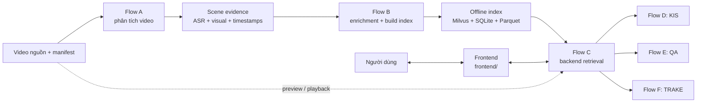
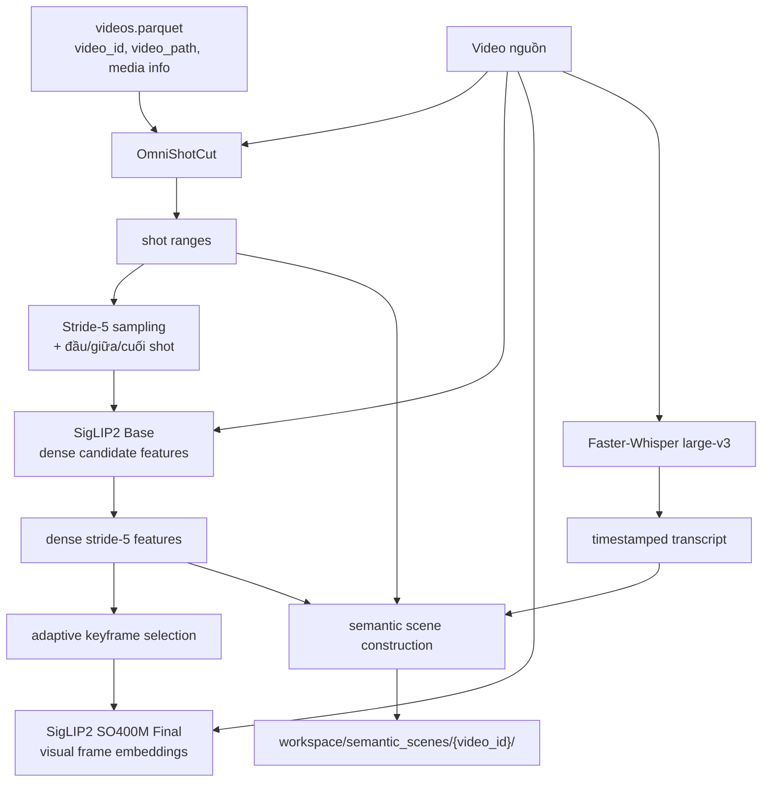
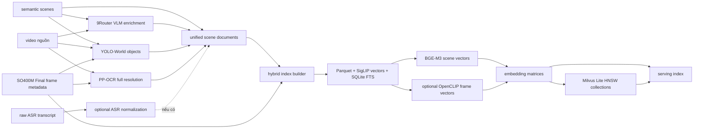
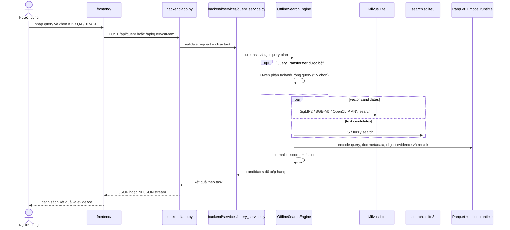

# AIC2026 Architecture

Tài liệu này mô tả toàn bộ hệ thống theo hai phần: pipeline offline tạo dữ liệu tìm kiếm và web app online phục vụ query. Flow A/B tạo và đóng gói index; Flow C là lớp truy vấn chung; Flow D/E/F là các tác vụ KIS, QA và TRAKE chạy trên lớp truy vấn đó.

## 1. Bức tranh tổng thể

Video, model weights và dữ liệu trong `workspace/` là artifact ngoài Git. Các script có thể tạo lại phần lớn artifact trung gian, nhưng web service cần một offline index đã build và model runtime có sẵn trên máy.

## 2. Thành phần trong repository

| Thành phần | Vai trò |
|---|---|
| `aic_pipeline/` | Logic dùng chung: phân tích query, truy xuất vector/text, fusion, QA evidence và task-specific ranking. |
| `scripts/` | CLI cho audit, inference từng stage, scheduler, enrichment, index build, query và serve. |
| `backend/` | FastAPI app, API schema, runtime dùng chung, query orchestration, QA và media endpoints. |
| `frontend/` | Web UI cho KIS, QA, TRAKE và kiểm tra video/frame. FastAPI phục vụ thư mục này cùng origin. |
| `environments/` | Các project `uv` tách dependency theo workload như serving, ASR, OCR và object detection. |
| `third_party/OmniShotCut/` | OmniShotCut source được ghim bằng Git submodule; checkpoint tải riêng. |
| `archive/`, `models/`, `workspace/` | Dataset, model weights, intermediate data và index; không được commit. |

## 3. Flow A — Từ video tới scene evidence

Flow A xử lý mỗi video thành các mốc thời gian, đặc trưng hình ảnh và transcript để các bước sau tạo scene document.

- `scripts/run_flow_a_scheduler.py` quản lý shot detection, sampling, SigLIP2 Base/Final, ASR và semantic scenes theo dependency riêng của Flow A.
- ASR và một số nhánh visual có thể chạy độc lập. Semantic scenes cần ASR cùng SigLIP2 Base evidence; nó không cần SO400M Final.
- SigLIP2 Base giữ đặc trưng dày để chọn keyframe và hỗ trợ temporal tasks. SO400M Final tạo vector retrieval cho frame đã chọn và metadata đầu vào cho OCR/object detection.
- Kết quả chính gồm `workspace/shots/`, `workspace/samples/`, `workspace/features/`, `workspace/retrieval/`, `workspace/asr/` và `workspace/semantic_scenes/`.

## 4. Flow B — Enrichment và đóng gói offline index

Flow B bổ sung bằng chứng văn bản/đối tượng vào scene, tạo unified scene documents rồi đóng gói metadata và embeddings để backend sử dụng.

Các nhánh OCR, object detection, VLM và ASR normalization làm giàu evidence theo video. Unified scene document hợp nhất caption/search text, transcript, OCR gắn với frame và object/spatial evidence. Các builder index chạy sau khi đầu vào đã sẵn sàng:

1. `build_offline_hybrid_index.py` tạo scene/frame Parquet, SigLIP vectors và `search.sqlite3`.
2. `build_bge_m3_scene_index.py` tạo vector văn bản cho retrieval text và các view như summary, ASR, OCR/entities.
3. `build_openclip_frame_index.py` tạo nhánh visual ensemble tùy chọn.
4. `build_milvus_index.py` nạp vector đã có vào Milvus Lite và lập HNSW index; bước này không encode lại dữ liệu.

### Vai trò của các artifact index

| Artifact | Backend dùng để |
|---|---|
| `milvus_lite.db` | ANN vector search với HNSW cho visual và text embeddings. |
| `search.sqlite3` | FTS/fuzzy lexical retrieval và lookup dữ liệu tìm kiếm. |
| `scenes.parquet`, `frames.parquet` | Metadata nguồn để nối vector hit thành scene/frame result. |
| `*.npy` embedding matrices | Nguồn vector để build/kiểm tra Milvus; cần đồng bộ với Parquet/report. |
| `milvus_report.json` | Kiểm tra số vector, dimension và fingerprint lúc backend khởi động. |
| `videos.parquet` | Ánh xạ `video_id` sang đường dẫn media và thông tin FPS/frame count/duration. |

Milvus collections lưu vector cùng row ID. Các thuộc tính scene/frame đầy đủ vẫn được tra từ Parquet; database Milvus không thay thế SQLite hoặc Parquet.

## 5. Flow C — Kiến trúc frontend/backend và retrieval online

Frontend là web app cùng origin do FastAPI phục vụ. Khi khởi động, backend nạp `Runtime`, `OfflineSearchEngine`, Milvus collections, Parquet metadata, model runtime và video manifest. Những phần này được giữ trong bộ nhớ để phục vụ query cho tới khi server dừng.

### Backend

- `backend/app.py` định nghĩa HTTP endpoints và vòng đời runtime.
- `backend/runtime.py` nạp engine/manifest và chuyển ranked hits thành dữ liệu UI. Runtime ánh xạ `video_id` với scene qua Parquet; client không gửi đường dẫn file.
- `backend/services/query_service.py` điều phối KIS/QA/TRAKE trên cùng `OfflineSearchEngine`.
- `aic_pipeline/offline_search_engine.py` chạy retrieval branches, score fusion và reranking.
- `aic_pipeline/task_router.py` phân loại query thành KIS, QA hoặc TRAKE. `query_understanding.py` tạo intent, variants và constraints; Query Transformer/Qwen có thể bổ sung structured parse.

### Một lượt truy vấn

1. FE gửi type/query và tùy chọn như `query_transformer` tới `/api/query` hoặc `/api/query/stream`.
2. Engine tạo query plan; nếu bật, Qwen phân tích query trên máy backend. Qwen không xem video, không tạo đáp án và không cần build lại embeddings.
3. Engine truy vấn Milvus cho các vector branches. BGE-M3 tạo text query vector; SigLIP2 tạo visual query representation; OpenCLIP chỉ tham gia nếu index có collection tương ứng và được bật.
4. SQLite bổ sung lexical/fuzzy hits. Object/spatial evidence, intent weighting và reranker cũng tham gia theo query.
5. Fusion xếp hạng candidates. Milvus ID nối ngược về metadata Parquet để API trả về `video_id`, `frame_id`, scene/time và evidence text.

Candidate pool API hiện được giữ ở 100 cho mỗi query hoặc event; `top_k` giới hạn số kết quả trả về. Index và model nạp từ local storage, còn các request KIS/TRAKE retrieval thông thường không cần gọi cloud.

SigLIP2/BGE-M3 query encoding và reranker chạy trên device backend chọn (`AIC_DEVICE`, mặc định CUDA nếu khả dụng). Milvus Lite HNSW và SQLite FTS/fuzzy chạy CPU. Qwen là process `llama-server` riêng và tự chọn GPU/CPU theo binary/runtime được cài.

## 6. Flow D — KIS: tìm video/frame

KIS dùng shared retrieval để xếp hạng scene/frame theo mô tả. Backend trả candidates và thông tin scene; frontend hiển thị frame, video và review controls. FastAPI lấy preview bằng cách giải mã frame từ video nguồn; media không được chép vào Milvus.

Dense moment refinement dựa trên SigLIP2 Base stride-5 features hiện chưa được nối vào request handler production. Vì vậy ranking hiện tại chủ yếu trả về retrieval candidates và frame đại diện.

## 7. Flow E — QA: tìm bằng chứng rồi trả lời

QA có hai phần riêng:

1. Retrieval tìm scene/frame candidates bằng Flow C.
2. FE cho phép chọn evidence frames rồi gửi câu hỏi cùng ảnh tới `/api/qa/answer`. UI hiện gọi Google AI Studio và trả lời dựa trên ảnh/câu hỏi.

QA có thể dùng OCR đã index để tìm evidence và chọn frame phù hợp. Gọi model tạo câu trả lời cần provider/API key; đây là bước online bên ngoài retrieval local. UI hiện gửi câu trả lời tới Google AI Studio và yêu cầu API key trong Settings. Backend có adapter 9Router và model-list endpoint, nhưng frontend hiện từ chối gọi QA answer với provider 9Router.

## 8. Flow F — TRAKE: tìm chuỗi sự kiện có thứ tự

TRAKE tách query thành event theo thứ tự, chạy retrieval chung cho từng event rồi tổng hợp candidate video và kiểm tra thứ tự các frame bằng `frame_id`. Kết quả gồm video và các frame tương ứng với từng event.

Dense `TemporalAligner` đã có trong codebase nhưng hiện chưa được gọi bởi request handler TRAKE. Luồng đang phục vụ dựa trên candidates theo event và thứ tự frame trong index.

## 9. Media và API boundary

| Endpoint | Dùng để |
|---|---|
| `GET /api/health` | Kiểm tra engine, Milvus và model runtime. |
| `POST /api/route` | Xem task router phân loại query như thế nào. |
| `POST /api/query` | Chạy retrieval và trả JSON đầy đủ. |
| `POST /api/query/stream` | Trả kết quả tiến triển theo NDJSON cho UI. |
| `POST /api/qa/answer` | Gửi evidence ảnh và câu hỏi tới QA provider. |
| `POST /api/qa/models` | Lấy model list từ provider. |
| `GET /api/frame/{video_id}/{frame_id}` | Decode/cache frame JPEG từ video gốc. |
| `GET /videos/{video_id}.mp4` | Phát video nguồn theo `video_id`. |
| `GET /api/videos/{video_id}/metadata` | Lấy FPS, frame count và duration. |

Backend tra đường dẫn media trong `workspace/manifests/videos.parquet`; preview cần file video tồn tại đúng đường dẫn đó. Frame JPEG có thể được cache dưới `workspace/ui_frame_cache/`.

## 10. Scheduler, state và tài liệu liên quan

- `run_flow_a_scheduler.py` quản lý riêng dependency graph của Flow A.
- `run_dataset_scheduler.py` theo dõi các stage offline/enrichment rộng hơn. Các supervisor phân phối xử lý video, gọi enrichment và khởi chạy các bước index khi dữ liệu sẵn sàng.
- Scheduler lưu state trong SQLite dưới `workspace/scheduler/` để có thể tiếp tục job.
- `docs/DATA_FLOW_AND_STORAGE.md` có bảng input/output và đường dẫn chi tiết từng artifact.
- `docs/REPOSITORY_GUIDE.md` mô tả thư mục, entry points và cách vận hành.
- `PIPELINE.md` giải thích model, fusion và hành vi retrieval/task.

